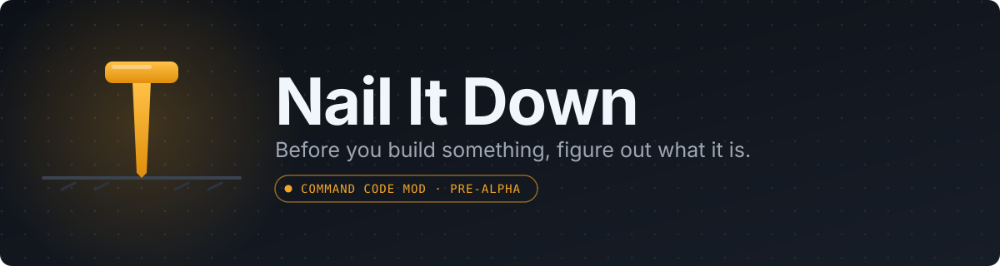
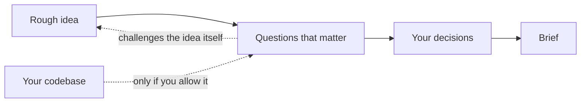

<p align="center">
  
</p>


<p align="center">
  <a href="https://github.com/beyondhumanwork/nail-it-down"></a>
  <a href="https://commandcode.ai/"></a>
  <a href="LICENSE"></a>
  <a href="https://github.com/beyondhumanwork/nail-it-down/issues"></a>
  <a href="CONTRIBUTING.md"></a>
</p>


<p align="center">
  <a href="#the-problem">The problem</a> ·
  <a href="#how-it-would-work">How it works</a> ·
  <a href="#principles">Principles</a> ·
  <a href="#faq">FAQ</a> ·
  <a href="#where-things-stand">Status</a> ·
  <a href="#contributing">Contributing</a>
</p>


---

**Nail It Down** is a planned [Command Code](https://commandcode.ai/) mod that catches expensive decisions before your coding agent turns them into code. You bring a rough idea. It asks the few questions that matter, and hands back a brief that a developer or an agent can build from.

> [!WARNING]
> **Pre-alpha. Not installable yet.** The first host milestone is done; the interview engine is still being built. Everything below describes what we plan to build, not what exists.

|                        |                                                |
| :--------------------- | :--------------------------------------------- |
| **Status**             | Pre-alpha. M0 merged; M1 in progress           |
| **Works with**         | [Command Code](https://commandcode.ai/)        |
| **Install**            | Not available yet                              |
| **Needs repo access?** | No. Optional and bounded, only if you allow it |
| **License**            | [MIT](LICENSE)                                 |

<details>
<summary><b>Table of contents</b></summary>


- [The problem](#the-problem)
- [How it would work](#how-it-would-work)
  - [An example](#an-example)
  - [What about the codebase?](#what-about-the-codebase)
- [Principles](#principles)
- [What it won't do](#what-it-wont-do)
- [FAQ](#faq)
- [Where things stand](#where-things-stand)
- [Contributing](#contributing)
- [Prior art and licensing](#prior-art-and-licensing)

</details>

## The problem

Coding agents have made code cheap to write. Deciding what to write is as hard as it ever was.

Say you tell an agent to add subscriptions to your app. It will build a billing flow, and probably a decent one. But there's a question it may never ask: **who is the subscriber?**

A person? A team? A company? These sound like the same feature. They aren't. The answer determines who pays, who has access, and what happens when someone leaves a team.

The agent will pick one anyway, and it won't tell you. By the time you find out, the decision is code.

Nail It Down exists to catch these decisions while they're still cheap to change.

## How it would work

You start with a rough idea. Nail It Down asks the questions that matter, tells you why each one matters, and keeps track of your answers.



Sometimes the most useful question is whether to build the thing at all. You may be about to rebuild a feature you already have, or spend a week on a problem a small change would fix. A good collaborator would say so. It's a waste to plan the wrong thing carefully.

### An example

```text
/naildown Add subscriptions to my app

Who pays for a subscription?
  1. Each person
  2. Each workspace
  3. Something else

Why it matters:
If the workspace pays, people can join and leave
without each needing their own subscription.

Choose an answer, or tell me what I've missed.
```

<sub>*Illustrative dialogue, not a recording of a working mod.*</sub>

You can change your mind, come back later, or ask what's still undecided. When the important questions are settled, the mod writes a brief that another developer or coding agent can build from.

The brief separates **what you decided** from **what the agent merely suggested**, and it lists what's still unknown. A good spec doesn't make uncertainty go away. It makes it visible.

### What about the codebase?

Sometimes the answer is already in the code. If you've built workspace membership, the mod shouldn't ask whether workspaces exist.

So, if you allow it, it can read a limited set of files and ask only about the choices the code can't answer. You can also use it without giving it repository access at all. Either way, it never treats something it hasn't checked as fact.

## Principles

1. **Ask the fewest questions that prevent an expensive misunderstanding.** Not the most.
2. **Explain why each question matters.** A question with no stakes attached is just friction.
3. **Keep decisions and suggestions apart.** What you chose and what the agent proposed are different things, and the brief says which is which.
4. **Make uncertainty visible.** Unknowns belong in the brief, not buried in an assumption.
5. **Never present the unchecked as verified.**
6. **Work without your repository.** Access is optional, bounded, and yours to grant.

## What it won't do

Nail It Down decides what to build. It doesn't build it.

| It will                                                    | It won't                                                |
| :--------------------------------------------------------- | :------------------------------------------------------ |
| Ask the questions that prevent expensive misunderstandings | Edit your code                                          |
| Explain why each question matters                          | Run project commands                                    |
| Inspect a limited set of files, only if you allow it       | Deploy anything                                         |
| Produce a brief that separates decisions from suggestions  | Treat approval of a brief as permission to implement it |

> [!NOTE]
> **Privacy, as designed.** Repository inspection is optional and bounded, and there's no separate telemetry service. When future versions ask a model to reason about your project, relevant inputs or approved snippets may go to your configured model provider and count against your usage. Saved state stored by the host shouldn't be assumed to be encrypted. None of these safeguards are implemented or verified yet.
>
> Details: [Privacy](docs/PRIVACY.md) · [Security](SECURITY.md)

## FAQ

<details>
<summary><b>Does it write code?</b></summary>


<br>

No. It decides what to build and stops there. It won't edit your code, run project commands, or deploy anything, and approving a brief is not permission to implement it.

</details>

<details>
<summary><b>Does it need access to my repository?</b></summary>


<br>

No. You can use it without granting any repository access. If you do allow it, it can inspect a limited set of files so it doesn't ask about things your code already answers.

</details>

<details>
<summary><b>What does the brief contain?</b></summary>


<br>

The decisions you made, the suggestions the agent offered (kept separate from your decisions), and the questions that are still open. Another developer or coding agent should be able to build from it.

</details>

<details>
<summary><b>Where does my data go?</b></summary>


<br>

There's no separate telemetry service. When future versions ask a model to reason about your project, relevant inputs or approved snippets may go to your configured model provider. See [Privacy](docs/PRIVACY.md) and [Security](SECURITY.md). These safeguards are still being implemented and verified.

</details>

<details>
<summary><b>Can I install it?</b></summary>


<br>

Not yet. We'll publish installation instructions once we've tested a working version.

</details>

## Where things stand

**M0 is done.** Command Code loads the mod, `/naildown` asks a question, saves the answer, and recovers it after a restart. Nothing else is shipped.

**M1 is in progress.** It adds the deterministic interview core: a versioned decision schema, a dependency graph, and the state transitions that record answers, invalidate what a change made stale, and keep approval separate from readiness. It is a pure TypeScript module with unit tests, not yet wired into the mod.

We still haven't published anything you can install.

| Milestone | Question it answers                                          | Status        |
| :-------- | :----------------------------------------------------------- | :------------ |
| **M0**    | Can Command Code load `/naildown`, ask a question, save an answer, and recover it after a restart? | ✅ Done        |
| **M1**    | Can the interview hold real decisions, respect dependencies, and refuse approval it hasn't earned? | 🚧 In progress |

The work is public:

- 🗺️ [Roadmap](docs/ROADMAP.md)
- 📝 [Product specification (draft)](docs/PRODUCT_SPEC_DRAFT.md)
- 🧱 [Architecture decisions](docs/ARCHITECTURE_DECISIONS.md)
- ✅ [M0 acceptance tests](docs/M0_ACCEPTANCE.md)

## Contributing

Contributions are welcome. It's early enough that they'll shape the project. Start with [CONTRIBUTING.md](CONTRIBUTING.md), or just [open an issue](https://github.com/beyondhumanwork/nail-it-down/issues).

A few good places to start:

- **Share a real example.** Has an agent ever made a decision for you without telling you? Open an issue describing it. Those are exactly the cases this mod should learn to catch.
- **Read the drafts.** The [product specification](docs/PRODUCT_SPEC_DRAFT.md) and [architecture decisions](docs/ARCHITECTURE_DECISIONS.md) are still open to feedback.
- **Help with M1.** The [roadmap](docs/ROADMAP.md) shows where the interview core is going. The [M0 acceptance tests](docs/M0_ACCEPTANCE.md) show what "working" means for the host integration that is already done.

## Prior art and licensing

This project is informed by existing open-source planning skills, including [the grilling workflow](https://github.com/mattpocock/skills). The implementation is independently written, and any adapted third-party material gets the notices its license requires.

See [research](docs/COMPETITIVE_AND_LICENSE_RESEARCH.md) and [third-party notices](THIRD-PARTY-NOTICES.md).

---

<p align="center">
  Maintained by <a href="https://github.com/beyondhumanwork">Beyond Human Work</a> · <a href="LICENSE">MIT licensed</a>
  <br>
  <sub><a href="#">Back to top ↑</a></sub>
</p>

