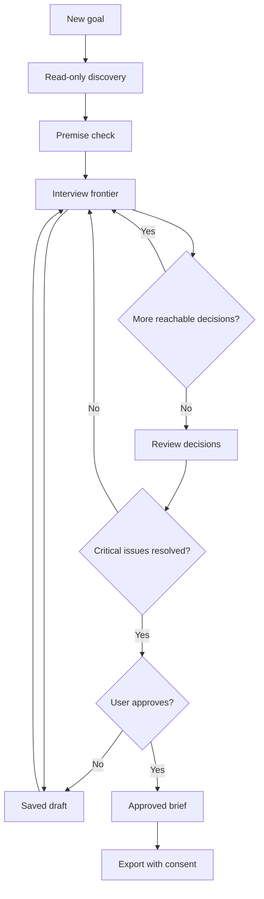

# Nail It Down — Product & Technical Specification

**Status:** DRAFT — for product review, not authorization to implement or publish  
**Version:** 0.1.0-draft  
**Date:** 2026-10-20  
**Working product name:** Nail It Down  
**Working command:** `/naildown`  
**Initial platform:** Command Code interactive TUI  
**License plan:** MIT, independently authored code, with upstream attribution and any required notices for adapted materials  
**Research basis:** `commandcode_first_three_mods_research_2026-10-20.md`, Command Code ModApi docs, Matt Pocock `grilling` documentation and issue discussions.

> **Positioning:** Stop guessing. Start building with clarity.  
> **One-sentence promise:** Nail It Down interviews you about a proposed change, checks what the codebase actually says, challenges risky assumptions, and produces a reviewed implementation brief—without writing implementation code.

## 0. Naming and brand gate

- Use **Nail It Down** internally pending clearance; never claim trademark or npm name availability.
- Product display name can change without changing workflow logic; the slash command and package name are configurable constants.
- Initial search found existing `NailDown` software in the contractor/roofing space. Do not publish under this branding until checking relevant US/Canadian trademark registries, npm/GitHub, similar software categories and confusion risk. Domain availability does not establish trademark rights.
- Names considered: Nail It Down, Talk It Through, Get Specific, Tough Questions, Iron It Out. `Hash It Out` is disfavored due to an October 2026 US trademark application involving AI-assisted communication software. Avoid `grill-me`/`grilling` branding or misleading affiliation.

## 1. Problem, user, and scope

### 1.1 Problem

Coding agents often implement a loosely described feature while quietly filling gaps with assumptions. The developer may spend more time correcting the result than clarifying the task would have required. Existing prompt-based interviewing skills help, but a conversation may be interrupted, assumptions may be reported as facts, recommendations may be accepted without understanding, and decisions may not survive into an implementation-ready artifact.

### 1.2 Primary users

- Solo developer using Command Code to build and maintain an existing codebase.
- Technical founder shaping a new feature or small project before commissioning implementation.
- Agent-heavy developer switching models or sessions and needing durable, reviewable decisions.

### 1.3 Core jobs-to-be-done

1. “I have a rough idea. Help me figure out what I really want.”
2. “Please challenge my assumptions before you code.”
3. “Read enough of this repo that you don't ask me factual questions already answered in files.”
4. “Give me a concise brief I can hand to a coding agent.”
5. “Let me return later without restarting the discussion.”

### 1.4 Non-goals — v0.1

No automatic coding, patch application, Git commits, test execution, deployment, external browsing, cloud account, SaaS backend, telemetry, cross-agent automatic import, PRD/ADR framework, multi-user collaboration, background agents, or automatic model routing. No guarantee that a generated specification is complete, correct, secure, or suitable for regulated work. No exhaustive repo indexing or arbitrary repository command execution.

## 2. Competitive reference and original differentiation

| Reference | Already provides | We must add or do better |
|---|---|---|
| Matt Pocock `grilling` | Dependency-aware design tree, question frontiers, recommended answers, fact/decision distinction | Explicit validated decision graph; durable resumable state; factual evidence; trade-off verification; independent outcome tests |
| `grill-with-docs` | Glossary and conditional ADR writes | Single portable implementation brief, no delegated skill prerequisite, zero repo writes until approved |
| Specsmith / prompt-grill | Interview and spec creation | Simpler native host experience, clearer approval and factual provenance, lightweight install |
| `before-you-build` skills | Product-risk challenge before coding | Extend into engineering requirements and acceptance criteria; do not conflate market validation with engineering readiness |

**Product thesis:** The differentiator is *not* that the agent asks questions. It is that the mod can demonstrably preserve the right decisions, distinguish evidence from suggestions, and avoid proceeding with unresolved critical ambiguity.

**Independent authorship:** Read competitors to learn techniques; do not copy their skill text or implementation into our package. If we later copy or closely adapt MIT-protected source/text, include original copyright and full permission notice in `THIRD-PARTY-NOTICES.md` and pin the upstream revision.

## 3. User experience

### 3.1 Happy path

```text
/naildown Add subscriptions to my SaaS

Nail It Down
Goal: Introduce subscription billing
Initial repo findings:
  ✓ Existing auth and user accounts (verified: src/auth/..., inspected 2026-...)
  ? Billing provider not found (not verified absent across entire repo)
  ! Biggest unresolved choice: account-level vs workspace-level subscription

Q1 — What is being billed?
  A. Each individual account
  B. Each workspace
  C. Something else
Suggested: B — matches existing workspace model, but affects ownership and proration.

Q2 — What should happen when payment fails?
  A. Grace period, then downgrade
  B. Disable paid features immediately
  C. Something else
Suggested: A — avoids abrupt disruption, but requires state handling.

[Answer selected questions; inspect implications; continue]

Review: 6 decisions, 2 assumptions, 1 deferred noncritical item
Critical blockers: 0
Action: Approve a Markdown implementation brief? [No by default]

Approved brief saved to user-chosen file.
No implementation changes were made.
```

Example contents and repo paths are illustrative; no claims about a real workspace are implied.

### 3.2 Typical command surface

| Command | Behavior | v0.1 status |
|---|---|---|
| `/naildown <idea>` | Begin interview for supplied goal | Must |
| `/naildown resume` | List/resume one saved workspace session | Must |
| `/naildown status` | Show decision summary, unanswered critical items and draft status | Must |
| `/naildown export` | Preview and request consent to save a Markdown brief | Must |
| `/naildown cancel` | End current interaction without discarding persisted data | Must |
| `/naildown forget` | Confirm deletion of one session's stored data | Should |
| `/naildown --quick` | Shorter interview with any residual uncertainty explicitly flagged | Later, not v0.1 |
| `/naildown import` | Import third-party decisions or cross-agent packets | Not v0.1 |

One slash-command registration with explicit argument parsing is preferred. If host interactions need asynchronous flow changes, test with a real session; command handlers and UI methods must not assume capabilities undocumented by the host.

### 3.3 Question design rules

- Begin with an early *premise check*: is this already implemented, contradictory, excessive, or not the smallest useful solution? It may conclude “don't build yet,” but the user decides.
- Ask only questions whose upstream prerequisites have been answered or explicitly labeled assumed.
- Prefer small groups of independent questions. Where the answer to one could invalidate another, separate rounds.
- For each question: plain-language title, why it matters, optional choices plus free text, agent recommendation, and meaningful consequence/trade-off. Never make recommendations sound like verified facts.
- The user may reject the recommended answer, defer noncritical matters, or reopen decisions. Critical unresolved issues prevent the **approved / ready** state.
- Favor questions about outcomes; explain technical terms when they are essential, not as a quiz of the user.
- No arbitrary mandatory question count. Stopping depends on unresolved decision dependencies and risk, not sheer question volume.
- Allow answer edits; mark dependent downstream decisions **needs_review**, rather than assuming they remain valid.

### 3.4 Approval and trade-off comprehension

Before marking the brief approved:
1. Show chosen decisions and any rejected alternatives with consequences.
2. Highlight the highest-impact 1–3 decisions and ask the user to confirm their understanding of trade-offs, with a *skip explicitly* option. The user does not need to pass a test; the aim is informed approval, not patronizing gatekeeping.
3. State critical unresolved items and all assumptions.
4. Request an affirmative, separate approval; default to No. Never interpret a model answer as user authorization.
5. Approval applies to the exported specification *only*. It never authorizes implementation, commits, deploying, or sharing data.

## 4. Functional requirements

| ID | Requirement | Verification |
|---|---|---|
| F-001 | Register one discoverable `/naildown` command | TUI command appears and dispatches |
| F-002 | Accept free-text goal and produce an initial plain-language problem statement | Golden fixture assertion |
| F-003 | Inspect a bounded allowlist of repo facts without changing project files | Read-only sandbox fixture |
| F-004 | Record provenance for every claimed verified repo fact | Fact schema validator rejects missing provenance |
| F-005 | Surface conflicting premises and at least one credible alternative where applicable | Ambiguous/scenario fixtures |
| F-006 | Represent decisions, assumptions and dependencies in a validated state structure | Unit tests for DAG and state invariants |
| F-007 | Never ask a dependent question before its prerequisites are resolved | DAG scheduling tests |
| F-008 | Present options, reason and trade-off; accept custom user answers | TUI integration |
| F-009 | Persist and resume a workspace session across process restart and mod reload | Restart test |
| F-010 | On changing a prior decision, invalidate affected descendants for review | Unit dependency tests |
| F-011 | Refuse to claim unverified facts or tests passed | Deliberately deceptive fixtures |
| F-012 | Render a reviewable concise Markdown brief with decision ledger and acceptance criteria | Snapshot tests |
| F-013 | Require explicit user approval before marking status approved or exporting a file | Confirmation tests, headless default No |
| F-014 | Support cancel/exit without losing already saved answers | Restart and interruption tests |
| F-015 | No network or process execution by default; no implementation writes | Side-effect instrumentation |
| F-016 | On model failure/invalid output, retain prior state and explain recovery options | Fault injection |
| F-017 | Provide a clear indicator when a question or fact is based on insufficient evidence | Fact/assumption rubric |
| F-018 | Support no-repo starting context with user-supplied goal and fewer repo-specific checks | Empty workspace test |
| F-019 | Avoid leakage of secrets by default in discovery/model context/export | Secret fixtures |

## 5. Domain model and invariants

Types below are a **design proposal**, not a statement about current Command Code host types.

```ts
type SessionStatus =
  | 'draft' | 'interviewing' | 'review' | 'approved' | 'cancelled';

type DecisionStatus =
  | 'open' | 'answered' | 'assumed' | 'deferred'
  | 'needs_review' | 'blocked';

type EvidenceKind = 'repo_file' | 'user_statement' | 'model_inference';

type Evidence = {
  id: string;
  kind: EvidenceKind;
  summary: string;
  path?: string;          // workspace relative; never an arbitrary secret path
  lineRange?: [number, number];
  contentHash?: string;
  capturedAt: string;
};

type Decision = {
  id: string;
  question: string;
  whyItMatters: string;
  options: {id: string; label: string; consequence: string}[];
  recommendation?: {optionId: string; rationale: string};
  priority: 'critical' | 'important' | 'minor';
  prerequisites: string[];
  status: DecisionStatus;
  answer?: {text: string; chosenOptionId?: string; actor: 'user'|'assumption'};
  evidenceRefs: string[];
  updatedAt: string;
};

type NaildownSession = {
  schemaVersion: 1;
  id: string;
  workspaceId: string; // stable normalized workspace identity, avoid exported absolute path
  goal: string;
  status: SessionStatus;
  decisions: Decision[];
  evidence: Evidence[];
  assumptions: {id: string; statement: string; acceptedByUser: boolean}[];
  unresolved: {id: string; description: string; critical: boolean}[];
  createdAt: string;
  updatedAt: string;
  approvedAt?: string;
};
```

### Non-negotiable invariants

- The dependency graph must be acyclic; references must exist.
- `approved` is impossible with open or blocked **critical** decisions, without explicit user sign-off, or with unacknowledged high-risk trade-offs.
- A `repo_file` fact without a safely verified path and provenance cannot be labeled `verified` in the UI/output.
- `model_inference` evidence never turns into repo verification automatically.
- All model-produced JSON is parsed, schema-validated, and checked for semantic consistency before state mutation.
- User answers have priority over model recommendations; downstream invalidation is deterministic.
- A failed model call cannot silently advance state or approve anything.

### State machine



## 6. Technical implementation architecture

### 6.1 Components

1. **Command adapter:** `cmd.addCommand`, argument parser, host capability checks, and lightweight TUI interactions.
2. **Discovery reader:** bounded, read-only local repository inspection, with symlink/path protections; output normalized evidence.
3. **Interview engine:** deterministic state transitions and validated dependency scheduling; never inferred from raw conversation alone.
4. **Model adapter:** targeted calls for premise critique, proposed decision graph, candidate questions and final editorial wording.
5. **Validation:** JSON schema checks, malformed output recovery, dependency cycle checks, provenance and approval gating.
6. **Persistence:** per-workspace state in `cmd.store` (host-managed persistent mod data); no unapproved project files.
7. **Exporter:** deterministic Markdown template, review preview, file-path validation and explicit confirmation.

### 6.2 Host API grounding

Command Code documentation (read 2026-10-20) describes:

- `cmd.addCommand({name, description, handler})`, handler receives `{args, ui, cwd, exec}` and may return `{prompt}` or `{message}`.
- `cmd.model.complete({prompt, system?, model?, maxOutputTokens?, signal?})` returns answered/unavailable/error/aborted results; it does **not** include transcript access or tools. Model usage is billed to the configured provider.
- `cmd.ui.confirm`, `cmd.ui.select`, `cmd.ui.input`, `cmd.ui.pane`; UI behavior differs by TUI/desktop/headless.
- `cmd.state` survives hot reload; `cmd.store` persists across sessions. Storage is host-managed, so avoid assuming transactionality or encryption without verification.
- Headless `confirm` resolves false; `select`/`input` resolve undefined. No automatic approval and no fake interactive interview in print mode.
- TypeScript mods can be loaded with `cmd --mod ./path.ts` before npm publication; API is experimental, so pin an actually tested Command Code release.

Documentation: https://commandcode.ai/docs/mods

### 6.3 Repository inspection: privacy-first defaults

- Opt-in only when an actual workspace exists; explain what categories are inspected. Starting `/naildown` may authorize the mod to read basic workspace metadata, not arbitrary files.
- Initial allowlist: `package.json`, relevant manifest names, `README.md`, `AGENTS.md` (treated as untrusted data), and filenames/paths in shallow directory summaries. Specific source files are read only as needed within stated limits, with the user told which files are inspected.
- Exclude known secrets and risky categories by default: `.env*`, credentials, keys, tokens, certificate material, dotfiles outside the approved allowlist, lockfile tokens, and user-designated ignored paths. Do not send complete lockfiles when version metadata suffices.
- Enforce workspace-root path containment after `realpath`, symlink and file-size limits, encoded-path handling, line/byte budgets, and per-run traversal cap.
- Every extracted fact has source path + snippet/line reference or is explicitly an inference. Absence of a match in a limited scan is **not** proof that functionality is absent.
- No network requests, shell execution, package installation, or remote retrieval unless explicitly introduced in a later version with separate consent and tests.
- If a user specifically supplies confidential or sensitive project context, warn before the mod sends it to the configured model provider; avoid additional third-party endpoints.

### 6.4 Model calls and schema robustness

Use limited calls for: (a) interpreting the goal / premise audit, (b) proposing a decision graph against gathered evidence, (c) next frontier questions, (d) producing a human-friendly brief summary. The code, not the model, owns statuses and approval.

- Validate each model output against a versioned JSON schema.
- Cap output tokens, input evidence and any retry count; on invalid output, retry once with a constrained correction prompt, then return a recoverable error without mutating decisions.
- Do not make additional speculative model calls merely to decorate the UI.
- Allow an explicit opt-out of repository reads (idea-only mode) and describe that resulting claims have lower grounding.
- The host's `cmd.model.complete` uses a model connection and consumes provider usage; **do not claim the mod is token-free**.

### 6.5 Durability, concurrency and export

- Store sessions keyed by a stable workspace identifier; select/resume if multiple exist. User may explicitly delete a session.
- Mark sessions stale or needing review if relevant evidence files changed since captured (hash/mtime verified on demand).
- Avoid simultaneous writes by serializing transitions in the mod. Determine whether `cmd.store` is safe for multiple running host instances; if not, detect concurrent edits or document as limitation.
- Save no arbitrary full raw transcripts; only decisions, bounded evidence, a minimal audit of edits and necessary user text.
- Export is a draft preview first. On approval, save under a user-chosen workspace-relative path using safe file creation and refusing accidental overwrite (unless separately confirmed). Default suggested path: `docs/naildown/<slug>.md`, not created without consent.
- Export should avoid embedding private absolute paths, unsanitized secrets, or machine-specific authentication details.

## 7. Implementation brief output contract

**Filename:** user-selected; suggested `<repo>/docs/naildown/<topic>.md`. The output should be portable to a fresh coding agent.

```markdown
# [Feature/Decision Title]

Status: Approved by user on [date] | Draft (not approved)
Source: Nail It Down v0.1, workspace [safe identifier]

## Objective
## Context and verified facts
- Fact, source path/line and capture date, or explicitly "unverified"
## User-facing behavior
## Scope
## Non-goals
## Requirements
- REQ-001 ...
## Decisions
- D-001: choice; why; trade-off; alternatives
## Assumptions and deferred decisions
## Acceptance criteria
- AC-001 Given/When/Then ...
## Verification plan
- Tests/checks required; no claim any test was already run
## Risks and open questions
## Next suggested implementation slice
## Approval and provenance
```

Rules: no invented completed tests; no invented file paths; all user decisions remain faithful even if the model recommends differently; no generated code; no silent substitution of product goals. Approval is a decision about the brief, not authorization for execution.

## 8. Failure, interruption and platform behavior

| Event | v0.1 behavior |
|---|---|
| User aborts question dialog | Keep valid prior state, offer resume |
| Model unavailable/error/aborted | Explain failure, keep state unchanged, suggest retry |
| Model JSON invalid | Single correction attempt, then explicit failure without data loss |
| Cycle in decision dependencies | Reject proposed graph, ask model to repair; no guessing |
| User changes earlier answer | Invalidate dependent decisions and re-evaluate frontier |
| Repo file disappears/changes | Flag evidence stale and remove verified status until rechecked |
| User requests export with unresolved critical blocker | Export *draft* only, clearly marked not ready |
| UI doesn't support interactive dialogs | Explain unsupported mode; don't interpret defaults as consent |
| Headless command | May produce static explanation/status; cannot claim an interactive approval occurred |
| No repo | Proceed with idea-only interview and explicitly state no repo validation performed |
| Secret encountered | Exclude/redact; do not print or store raw secret |
| File path outside workspace or symlink escape | Refuse export/read, explain safe alternative |

## 9. Acceptance and evaluation plan

### 9.1 Product-level release gates

- **G-01 No unauthorized writes:** 100% of tests show no implementation files, network calls, process execution or repo writes until an explicitly approved export.
- **G-02 Truthfulness:** 0 invented verified repo facts in the seeded evaluation set; all verified claims have visible provenance.
- **G-03 State correctness:** 100% of graph dependency / invalidation unit tests pass; no critical question is skipped due to a graph error.
- **G-04 Resume:** session survives restart, reload and interrupted question without re-asking settled valid decisions.
- **G-05 Honest blocking:** unresolved critical issue always prevents approved status.
- **G-06 Privacy:** secret fixtures are not transmitted to model input or included in export; path traversal and symlink escapes fail closed.
- **G-07 No false success:** failing/unsupported host paths never report successful approval/export.
- **G-08 Baseline comparison:** on the same seeded tasks/model/budget, show at least one material improvement over direct prompting and upstream `grilling` in decision durability, provenance or detecting missing requirements; document regressions.

### 9.2 Small, affordable benchmark

Build a fixed evaluation set of 20 scenarios: 5 vague new features, 5 existing-project changes, 5 conflicting/ambiguous constraints, 5 already-clear or premature-to-build tasks. For each, prepare an independently written set of 3–8 *critical requirements or risks* and expected source evidence. These rubrics must not be created by the evaluated model from its own outputs.

Compare three methods on the same model and available context: (1) original plain prompt, (2) upstream `grilling` skill, (3) Nail It Down. Track: critical omission recall, unsupported facts, number of rounds, median intervention burden, artifact consistency, resume performance, token usage and cost. Use limited spot checks with a second low-cost model to expose robustness gaps. Treat targets as launch criteria to refine with actual measurements—not claims that have been achieved.

### 9.3 Specific unit and integration fixtures

- Two independent decisions in same frontier; one decision depends on one of them.
- Question invalidated by a changed upstream choice.
- Previous answer remains after restart and reloading mod.
- User says “yes” without acknowledging critical trade-off; status not auto-approved.
- Empty project, conflicting README/AGENTS.md, huge files, cyclic symlink, `.env` with fake API key.
- Malformed model responses, missing fields, repeated IDs, cycles and fake source paths.
- File changes between discovery and approval.
- No-UI headless, SSH clipboard absence, and mod name collision.
- Export denied, export accepted, overwrite refused, and export file marked draft when blocked.

## 10. Packaging and operations

### 10.1 Minimal package layout

```text
nail-it-down/
  package.json
  LICENSE
  README.md
  THIRD-PARTY-NOTICES.md
  CHANGELOG.md
  src/
    index.ts
    commands.ts
    interview.ts
    decision-graph.ts
    evidence.ts
    persistence.ts
    model.ts
    export.ts
  tests/
    graph.test.ts
    persistence.test.ts
    privacy.test.ts
    export.test.ts
    fixtures/
  examples/
    before-after.md
    sample-brief.md
```

Package name to be chosen and checked. Documentation shows packages can expose source paths through `package.json`:

```json
{
  "name": "<unreserved-package-name>",
  "keywords": ["cmd-mod", "cmd-mod-command"],
  "commandcode": {"mods": ["./src/index.ts"]}
}
```

Replace the placeholder only after npm clearance; pin actual runtime deps. No required separate skill package. Optional standalone cross-agent skill is a **later** consideration, not MVP.

### 10.2 Cheap testing and publishing discipline

- Unit tests and static checks use local fixtures; develop on a capable remote environment if the development machine cannot build or test reliably.
- No automatic CI on every push. Use manual (`workflow_dispatch`) constrained integration/release workflow with spending controls and path filters if practical; never claim GitHub $0 spending settings enforce all downstream providers.
- Keep npm runtime dependencies minimal and license-audited; use read-only token scopes for non-release tasks.
- Package inspection: `npm pack --dry-run` on supported environment to verify no `.env`, private files, fixtures with credentials or transcript samples ship.
- Publish first to npm only after name clearance and tests; submit reviewed Mods Hub registry PR separately. Registry inclusion is not automatic.
- Record tested Command Code versions and host TUI behavior; ModApi remains experimental and may break.

## 11. Implementation order and approval gates

**Thin slice first** (the smallest thing worth proving):

1. Local registration + `/naildown <idea>` command and deterministic no-write UI.
2. Single-question round using host modal; persist one user choice across restart.
3. Dependency graph and safe next-frontier handling.
4. Bounded evidence reader with provenance and privacy fixtures.
5. Structured model-backed question generation with validated schema/failure recovery.
6. Review screen + preview-only Markdown generation.
7. Consent-gated export and explicit draft/approved state.
8. End-to-end integration tests, benchmark, package audit, release.

**Gate A — Specification review:** user agrees on user promise, default flow, question format, data boundary and brand direction. **No implementation yet.**

**Gate B — Feasibility spike:** run minimal mod against a pinned real Command Code version to verify `addCommand`, dialogs, state/store, model calls and interruption behavior. Spike code is not automatically a product.

**Gate C — Benchmarked MVP:** all critical acceptance gates, documented limitations, no red secret fixture, and material evidence of improvement over existing alternatives.

**Gate D — Publication:** namespace + trademark review, all license notices, README examples, minimum dependency audit, optional manual CI, npm, then Mods Hub PR.

## 12. Open product choices (with proposed defaults)

These are decisions for review; do not block preparatory implementation *planning*, but do not silently declare approved:

| Decision | Recommended draft default | Reason |
|---|---|---|
| Working name | Nail It Down | Plain English; clearly communicates settling requirements; requires clearance |
| User interface | Native TUI dialogs, with lightweight pane/status | Feasible documented surface; avoid elaborate UI in first release |
| Repository access | Metadata/read-only allowlist, explicit consent for deeper reads | Trust and privacy |
| Model usage | Host-configured model, bounded calls | No separate API key or service |
| Interview length | No fixed number of questions; stop on resolved decision frontier | Minimizes premature completion and arbitrary caps |
| Resume persistence | Host `cmd.store`, workspace-scoped | Avoid default writes in user repo |
| Markdown output | One compact, reviewed brief | Works across agents and easy to inspect |
| Publishing license | MIT | Permissive and familiar to developers |
| Cross-agent adapters | Defer until first release proves value | Avoid complexity before adoption |
| Build pipeline | Minimal local/remote-on-demand tests, manually triggered release | Avoid wasting CI minutes |

## 13. Evidence and source list (researched 2026-10-20)

- Command Code ModApi documentation: https://commandcode.ai/docs/mods
- Command Code Mods Hub: https://commandcode.ai/mods
- Matt Pocock `grilling` behavior: https://github.com/mattpocock/skills/blob/main/docs/productivity/grilling.md
- Matt Pocock `grill-with-docs` behavior: https://github.com/mattpocock/skills/blob/main/docs/engineering/grill-with-docs.md
- Matt Pocock `grilling` skill source: https://github.com/mattpocock/skills/blob/main/skills/productivity/grilling/SKILL.md
- Matt Pocock issue on dependency ordering: https://github.com/mattpocock/skills/issues/895
- Matt Pocock issue on user understanding and approval: https://github.com/mattpocock/skills/issues/1096
- Matt Pocock issue on plain-language user options: https://github.com/mattpocock/skills/issues/962
- MIT reference license: https://github.com/mattpocock/skills/blob/main/LICENSE
- Existing pre-build category competitor: https://github.com/bin1874/before-you-build-skill
- Existing `NailDown` brand: https://getnaildown.com/
- Existing `Hash It Out` trademark application: https://trademarks.justia.com/501/40/hashitout-50140394.html
- Previous first-three-mods diligence: `commandcode_first_three_mods_research_2026-10-20.md`

---

**Current state:** Product/technical specification *draft completed*. No code, repository changes, npm package, trademark filing, or Mods Hub registry submission has been performed by this document. The remaining deliberate gate is to review the user-facing experience and risk/privacy defaults before implementation.